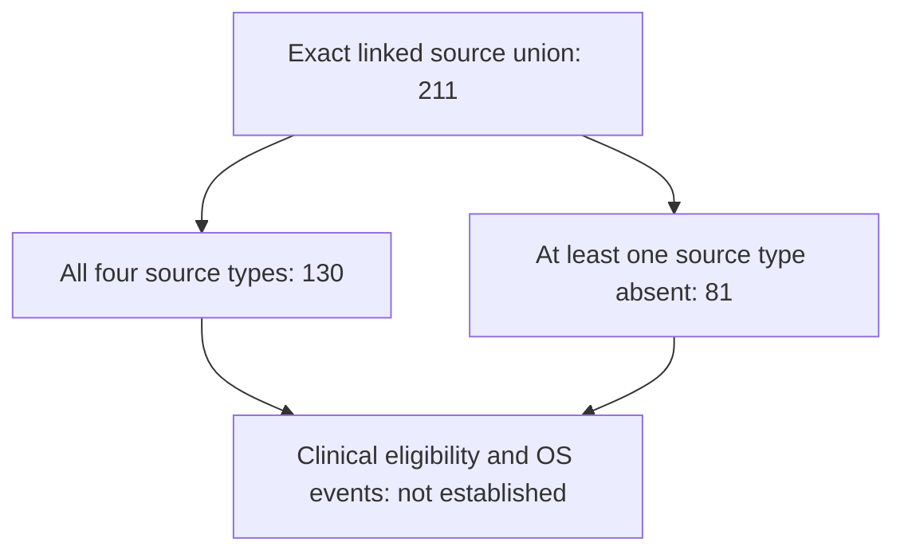

# Observed source inventory flow

Counts describe repository evidence, not a clinically eligible prognostic cohort.

No participant is excluded from the inventory for missing optional evidence. Clinical inclusion/exclusion counts remain unassessed pending source adjudication.
